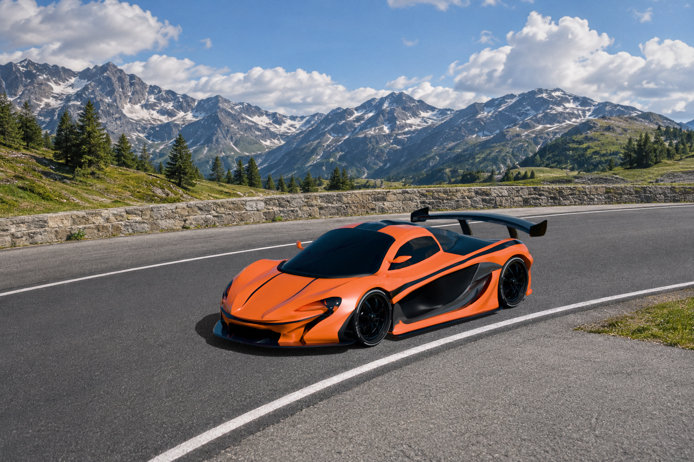
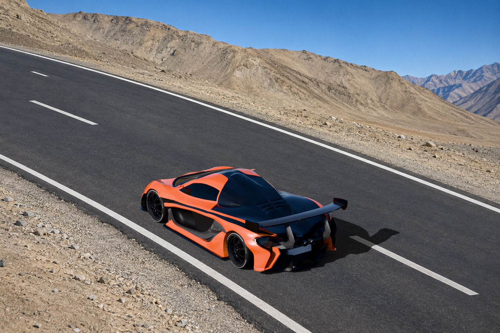
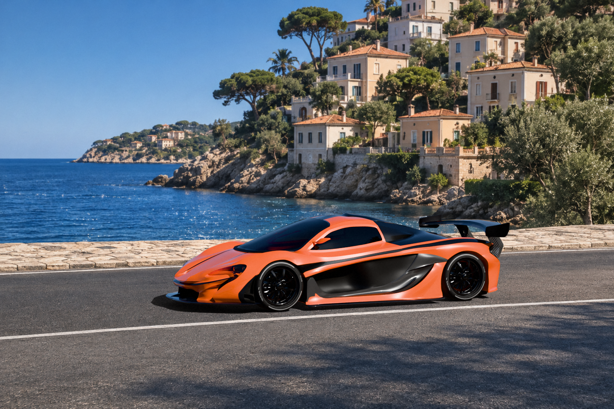
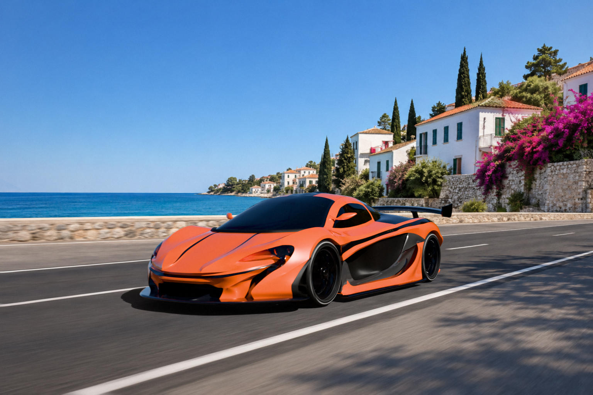
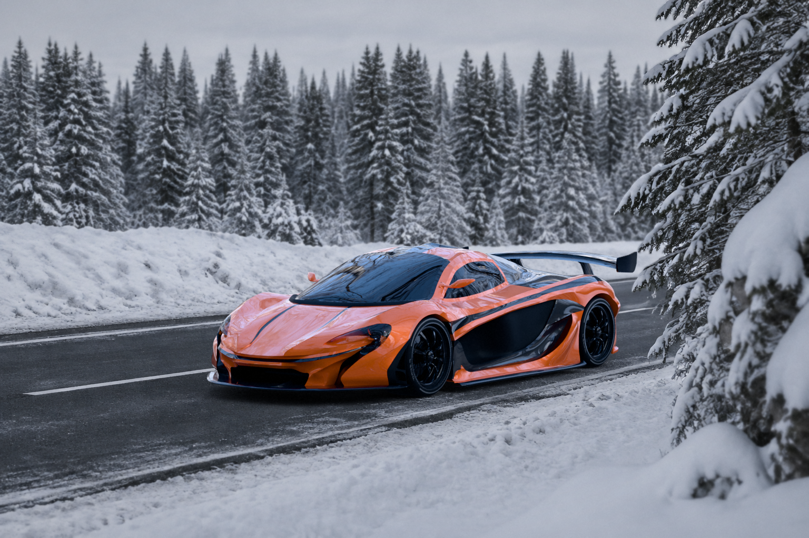
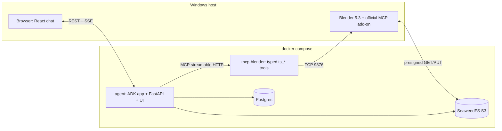
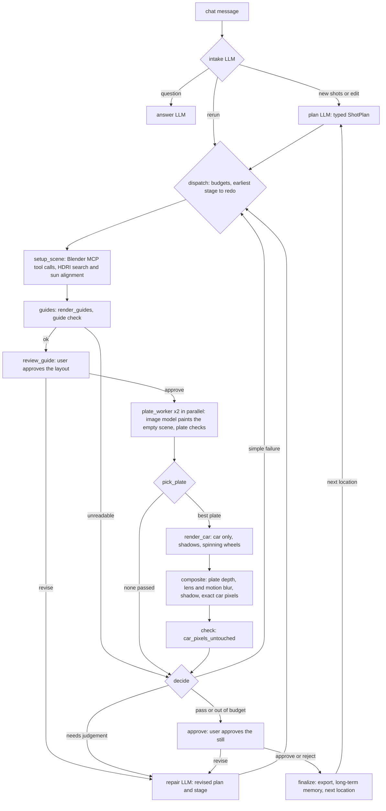

# trueshot

A locally running agent that makes photoreal marketing stills of one exact car in any location. Blender, driven through typed MCP tools, builds the set, renders layout guides and renders the car; an image model paints only the empty scene; the exact car render is composited on top and checked. The image model never draws the car.

Architecture, modules and extension points: [`docs/architecture.md`](docs/architecture.md).

Final stills and the passes each was made from (plate, guides, masks, car render and EXR, plate depth, layout, run record): [`results/`](results/). Failure log: [`FAILURES.md`](FAILURES.md).

| Alps | Ladakh | Coastal town |
|---|---|---|
|  |  |  |

| Mediterranean coast (recomposite) | Norway (recomposite) |
|---|---|
|  |  |

## Architecture

### The agent graph

One chat message runs one Google ADK 2 Workflow. LLM nodes decide only where judgement is needed (intake, plan, repair, answer); plain-code nodes run the expensive stages and call the typed Blender tools. Every retry goes through `dispatch`, which enforces the budgets in code and jumps to the earliest stage that has to be redone. Both human approvals are persisted `RequestInput` pauses, so the stack can restart while it waits.

What happens for "Make a launch still of the car driving through the Swiss Alps":

1. **intake** sorts the message: question, new shots, edit of a stored shot, or rerun.
2. **plan** designs the shot as a typed `ShotPlan`: road pieces and stand-in elements, car placement, camera (angle, height, lens, framing, f-stop), motion, light, grade, livery. It reads long-term memory (approved shots, looks, product facts).
3. **setup_scene** turns the plan into typed MCP calls, one visible step each: `setup_blender`, `load_car`, `set_materials`, `reset_scene`, `build_set`, `place_car_on_road`, `frame_shot`, `find_hdris` (Poly Haven, vision pick), `set_lighting` (sky turned to the planned sun), `save_blend`. The calls are recorded so the scene can be rebuilt exactly.
4. **guides** renders the car-hidden grey blockout, depth, road and car masks; the agent derives a line guide. `guide_readable` rejects a guide with no visible road before any image is paid for.
5. **review_guide** shows the guide to the user: approve, or revise with a note (the guide is rebuilt and shown again).
6. **plate_worker x2** asks the image model to paint the empty scene from the guides, reference photos and the real sun and lens; `plate_not_blank` and `layout_match` score each plate and the best one is kept.
7. **render_car** renders only the car in Cycles, lit by the same sky, wheels spinning, shadows on a shadow catcher; PNG and EXR.
8. **composite** measures the plate's depth (Depth Anything V2), blurs the plate for depth of field and the rolling shot, lays the shadow, puts the exact car on top, adds light wrap, vignette and grain.
9. **check** asserts the car pixels equal the render; **decide** sends simple failures back to `dispatch`, others to the **repair** LLM, and passing shots to the user.
10. **approve / finalize**: approve exports the still and every pass to `outputs/<location>/<job>/` and writes the shot's settings to long-term memory; revise goes to repair; the next queued location starts.

### Data model

- **Postgres, ADK tables:** `sessions` (short-term state: the current `shot`, `run`, `gallery`, `spend`, stored `shots`), `events` (the chat and every step), `user_states` (long-term memory: `user:approved_shots`, `user:looks`, `user:settings`), `app_states` (`app:product_facts`).
- **Postgres, trueshot tables:** `ts_jobs` (one row per shot: status, plan, final key, verdict, score), `ts_candidates` (every composite with its scores), `ts_tool_log` (every tool call with args, result and duration).
- **S3:** the car model (`cars/`), reference photos, and per attempt `jobs/<job>/a<n>/` guides, plates, depth, car render, composite; `jobs/<job>/final.png`. The database stores object keys, never image bytes.

## Approach and key decisions

- **Render and composite, not generate the car.** Reference or control conditioning and image-edit models redraw the whole frame, so spokes, badges and lamp shapes drift; a product LoRA needs training data, GPU time and still drifts on fine detail, which a one-day build and a $60 key cannot cover. The car is a Cycles render of the GLB (real paint, lit by an HDRI aligned to the scene's sun); the image model (OpenAI `gpt-image`, edit mode) paints only the empty scene from Blender guides (grey blockout, line and depth passes) and location photos. The composite keeps every opaque car pixel, and `car_pixels_untouched` proves it on every still.
- **Realism around an exact car:** shadow catcher and contact shadow on the road, paint reflections from a Poly Haven HDRI picked per location by a vision call and rotated to the plate's sun, stand-ins hidden from reflections, depth of field and rolling-shot blur from the plate's own depth (Depth Anything V2), wheel motion blur in the render, light wrap and an exposure grade from the EXR.
- **Agent graph (Google ADK Workflow):** LLM nodes decide only where judgement is needed (intake, plan, repair); plain-code nodes run the expensive stages; a `dispatch` hub enforces image, loop and spend budgets in code and jumps to the earliest stage that must be redone; approval is a persisted `RequestInput`. Every tool call is a visible step in the UI and a row in Postgres.
- **Typed Blender MCP tools** on the official Blender MCP server (`load_car`, `build_set`, `place_car_on_road`, `frame_shot`, `set_lighting`, `render_guides`, `render_car`, …), not a run-Python tool.
- **Memory:** ADK sessions in Postgres (short-term chat and graph state); long-term memory in `user:`/`app:` state keys (product facts, livery, approved shot settings), which the planner reads; images live in S3, the DB holds keys only.
- **Best of two plates** per attempt, in parallel (`PLATE_CANDIDATES`): same wall time, a fallback when one plate breaks the layout.

## Assignment checklist

| Required | How trueshot does it | Where |
|---|---|---|
| LLM orchestration | ADK 2 Workflow from one chat request to finished stills: plan, set up the guide, generate, check, retry. Graph state is persisted in Postgres; every tool call is a step in the chat and a `ts_tool_log` row with args, result and duration. | `agent/agents/trueshot/graph.py`, `steps.py`, `plugins.py` |
| Blender MCP server | The official Blender MCP server extended with 17 typed `ts_*` tools (`load_car`, `place_car_on_road`, `frame_shot`, `render_guides`, `build_set`, `set_lighting`, `render_car`, …). | `mcp/blmcp/tools/` |
| Blender as the guide | The planner LLM designs road, set, car pose and camera; the graph executes them as MCP calls you can watch in the viewport (paced by `TS_STEP_PAUSE_S`). The guide is checked and shown for approval before any image is made. | `nodes/setup.py`, `scene.py`, `nodes/guides.py`, `nodes/review_guide.py` |
| Chat UI | React app on :8000: chat, live steps, guide and final approval cards, gallery with scores, session list with resume, memory drawer, health lights. | `ui/src/` |
| Persistent chat and session memory | Sessions survive `docker compose down` / `up` and resume by id (session list or `?s=<id>`). Short-term: session events and state. Long-term: approved shot settings, looks and product facts, read by the planner ("make the Ladakh shot golden hour like last time"). | `memory.py`, `shot.py` |
| Model endpoint | OpenAI by default. `LLM_MODEL` and `LLM_API_BASE` switch to Ollama, Docker Model Runner or any OpenAI-compatible server; `IMAGE_BACKEND` switches the image model (`openai`, `fal`, `fake`). No code change. | `llm.py`, `app/imagegen/` |
| Image generation | The image model paints only the empty scene; the car is the Blender render composited on top, and `car_pixels_untouched` proves its pixels are exact. | `nodes/plates.py`, `app/compositing.py`, `app/checks/` |
| Local DB and object storage | Postgres for sessions, memory and job state; SeaweedFS (S3-compatible) for the car model, guides, renders and finals; the DB stores keys only. | `app/db.py`, `app/storage.py` |
| Local orchestration | `docker compose up -d` starts everything except Blender; `.env.example` lists every setting. | `docker-compose.yml`, `.env.example` |

Stretch goals:

- **Automated accuracy gate:** every final is scored against the clean car render on the car mask (≥ 99.5 % of opaque car pixels within 2 levels); the score is shown per still in the gallery and stored in the exported `run.json`. Guide and layout failures retry with a changed plan through `repair`. A changed car pixel stops the run, because no plan change can fix a compositing bug. Not done: a vision checklist of the car's parts on the final.
- **Tracing:** partial. Each step and tool call is logged with its latency and shown in the chat, and LLM and image spend is metered per session. No OpenTelemetry or Langfuse export.

## Demo

Prompts that work as they are:

- Make a launch still of the car driving through the Swiss Alps: a mountain pass with a hairpin road and snow on the peaks.
- Make a launch still of the car driving through Ladakh: a high-altitude desert road, barren mountains, hard light.
- Make a launch still of the car driving along the beach road of a Mediterranean coastal town, with the sea and buildings in frame.
- After a restart: Make the Alps shot golden hour, keep everything else.

## With one more week

- A vision accuracy gate on the final still against a checklist built from the real car's specs (spokes, badges, lamp signature), in addition to the pixel assertion.
- Relighting the car render from the generated plate (estimated light from the plate, not only the HDRI) and a learned harmonisation pass at the car edge.
- Calibrate `layout_match` thresholds on a larger set of plates; add a horizon and perspective check.
- OpenTelemetry traces per run (step, tool call, latency, cost) exported to a self-hosted collector.
- Resume that can repair a corrupted invocation instead of replaying it.

## Quick start

Requirements: Docker (Engine in WSL2, or Docker Desktop), Blender 5.1 or newer on the host, an OpenAI API key.

1. **Blender (host, once).** Install the official Blender MCP add-on and the startup script that binds it where the containers can reach it:
   - WSL2: `scripts/host/setup-host.sh` (add `--wslconfig` so Docker keeps running when terminals close).
   - Elsewhere: copy `blender_addon/blender_mcp_addon` into Blender's `scripts/addons/` and `scripts/host/trueshot_blender_startup.py` into `scripts/startup/`.
   - In Blender, turn on Preferences > System > Allow Online Access. Keep Blender open.
2. **Settings.** `cp .env.example .env` and set `OPENAI_API_KEY`. Every other variable has a working default; `IMAGE_BACKEND=fal` plus `FAL_KEY` switches the image model, `LLM_API_BASE` points the LLM at Ollama or another OpenAI-compatible server. Image quality and LLM thinking effort are chosen per message in the chat header.
3. **Assets.** Put the car GLB in `assets/cars/` (and optionally `assets/product_facts.json`, location photos in `assets/refs/<location>/`). Skies are searched and downloaded from the Poly Haven API at run time, so Blender needs internet access; `python3 scripts/fetch_hdris.py` downloads a local set (optional).
4. **Run.** `docker compose up -d`, then open http://localhost:8000. The header's health lights show Blender, storage, database, image backend and LLM.

## Development

- Tests: `cd agent && uv run --group dev pytest -q`; `cd ui && npm test`.
- Plate depth (blur) uses Depth Anything V2 Small (Apache-2.0, ~100 MB). The agent image bakes the weights in at build time; outside Docker they download on first use to `MODELS_DIR` (default `~/.cache/trueshot/models`), pinned and SHA-256 checked.
- Offline end-to-end run of the whole graph (real Blender, fake plates, scripted LLM, no API cost): see the header of `agent/tests/e2e_offline.py`.
- A throwaway Blender instance with its own profile for tool development: `scripts/dev/blender_instance.sh start <name> <port>`.
- Dev ports (Postgres 5433, MCP server 8765): `docker compose -f docker-compose.yml -f docker-compose.dev.yml up -d`.
