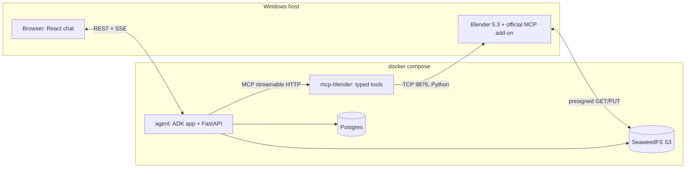
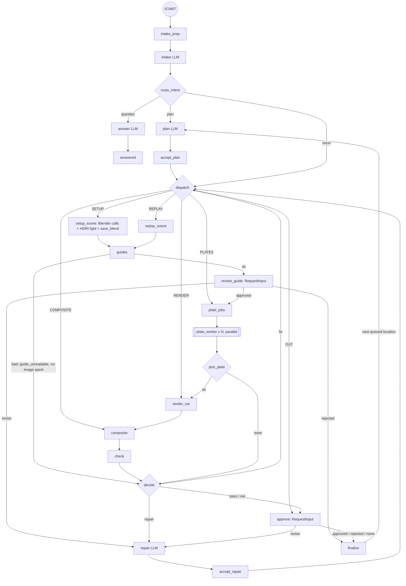

# Architecture: modules, seams and extension points

Goal: adding or removing a Blender tool, an image backend, a check, a graph step or a UI panel touches **one file plus one registration line**, and nothing else.

## Runtime

## Modules and their interfaces

| Module | Interface (what callers learn) | Hides | Adapters at the seam |
|---|---|---|---|
| **Blender tool** (`mcp/blmcp/tools/ts_<name>.py` + `_toolcode.py`) | MCP tool name, flat typed params, result dict with `status` | bpy code, start/poll for long work, presigned uploads, settings restore, viewport redraw, pacing | one per tool; auto-discovered |
| **`BlenderClient`** (`agent/app/blender.py`) | `await call(tool, **args) -> dict`, raises `BlenderToolError(status, message)`; `health()` | MCP session handling, result parsing, timeouts, reconnect after an MCP restart | MCP (real), in-memory fake (tests) |
| **`ObjectStore`** (`agent/app/storage.py`) | `put`, `get`, `size`, `list`, `public_url`, plus `put_json`/`get_json` | S3 signing, path-style addressing, retries, bucket bootstrap | `S3Store`, `MemoryStore` (tests) |
| **`Database`** (`agent/app/db.py`) | job, candidate and tool-log rows; `health()` | pool, schema migration, interrupted-job recovery | Postgres only |
| **`ImageBackend`** (`agent/app/imagegen/`) | `generate(PlateRequest) -> PlateResult`, `estimate_cost`, `health` | provider SDKs, uploads, queue polling, retries, safety-output rejection | `openai`, `fal`, `fake`; chosen by `IMAGE_BACKEND` |
| **LLM** (`agent/agents/trueshot/llm.py`) | `make_model() -> BaseLlm` | provider choice (`LLM_MODEL`, `LLM_API_BASE`) | OpenAI Responses, any OpenAI-compatible server; a scripted model in `tests/e2e_offline.py` |
| **`Services`** (`agent/app/services.py`) | `services()` returns the store, Blender, db and image backend | construction from settings | real (startup), fakes (tests) |
| **Session state** (`agent/agents/trueshot/state.py`) | `set_run`, `add_gallery`, `add_spend`: the only writers of the keys the UI reads | key names and shapes of the UI contract | n/a |
| **Steps** (`agent/agents/trueshot/steps.py`) | `tracked(ctx, name, args, work)` yields the running/final `ts_step` events, then the result | `ts_step` event shape, tool-log rows, timing | n/a |
| **Shot state** (`agent/agents/trueshot/shot.py`) | `load(state) -> ShotState`, `save(state, shot)`, `next_stage(shot, wanted, spend)` | the typed `shot` key every stage reads (so any edge can enter a stage); budget rules | n/a |
| **Memory** (`agent/agents/trueshot/memory.py`) | `remember_approval`, `summary`, `product_facts`, `car_key`, catalogs | `user:`/`app:` state keys, assets lookup | n/a |
| **Checks** (`agent/app/checks/`) | `run_checks(stage, CheckContext) -> list[CheckResult]` | each check's metric and threshold; errors become non-blocking failures | registry list `CHECKS` |
| **Compositor** (`agent/app/compositing.py`) | `load_car_render(png, exr)`, `composite(plate, car, depth_m=, lens=, tracking=) -> Composite` | colour spaces, plate depth of field and rolling-shot blur, shadow-catcher multiply, alpha-over, light wrap, lens finish | n/a |
| **Plate depth** (`agent/app/imaging/depth.py`) | `estimate_plate_depth(plate, blender_m, road) -> PlateDepth` (metres, inf = sky) | Depth Anything V2 Small on ONNX (CPU, ~1 s), pinned weights (`depth_weights.py`, SHA-256), calibration to metres on the road against Blender's depth | n/a |
| **Graph** (`agent/agents/trueshot/graph.py`) | the edge list | node wiring and routes | n/a |
| **Plugins** (`agent/agents/trueshot/plugins.py`) | `all_plugins()` | tool log, replayable scene calls, LLM spend meter and soft call cap | n/a |
| **UI** (`ui/src`) | panels render a derived `ViewState` | ADK event parsing (`events.ts`, a pure reducer), HTTP (`api.ts`) | n/a |

## Graph

A verified pipeline with a repair router. Plain-code nodes run the visible, expensive stages, exactly the pipeline of the reference lab script `scripts/dev/lab.py`; the LLM decides at `intake`, `plan` and `repair`. Every pass and retry goes through `dispatch`, which enforces the budget in code and jumps to the earliest stage that must be redone.

The plan (`schemas.ShotPlan`) is data the code turns into tool calls, and nothing in it is picked from a menu: the planner designs each shot for its place. `set` is the blockout (`road`: straights and turns of any radius and angle, e.g. stacked switchbacks; `elements`: stand-in groups of the kinds hillside, mountains, buildings, trees, sea, wall, each with a side of the road and its sizes), `placement` puts the car anywhere along the road (e.g. a hairpin apex) in a lane, `camera` is any azimuth, elevation (up to aerial), lens and framing, either of the whole car or of a detail (an aim point on the car's bounding box plus the width to frame), with its f-stop; `motion` is the exposure (speed, shutter, tracking). `concept` names the idea and `ideas` (in `PlanOutput`) offers the user 2-3 other shots. The prompt (`prompts.STATIC_PLAN`) gives the conventions and photographic principles (distance and lens vs proportions, aerials, details) and the cameras already used in the session, so shots vary. `light` has `hdri_query` for `find_hdris`, `sun_rel_deg` relative to the camera (default ~135 = sun behind the camera's shoulder), `time_of_day` words (daylight by default); plus `scene_prompt`. `setup_scene` runs `scene.setup_ops` (load_car, set_materials from the livery, reset_scene, build_set, place_car_on_road, frame_shot), then find_hdris + `app.hdri_pick.pick_hdri` (one vision call over the thumbnails) + set_lighting (HDRI sun aligned to the camera-relative direction) and save_blend; it stores the camera, placement, chosen HDRI and sun words in `shot.scene` (replays keep the HDRI while the query is unchanged). Plates get the sun words and camera words in their prompt; `render_car` uses the plan's exposure (`camera.car_motion_args`) and reflects the HDRI only; `composite` applies the rolling-shot tracking blur and depth of field to the plate (by the plate's own depth), light wrap, vignette and grain. A plan change that touches the set, placement, camera framing or light restarts at SETUP (`shot.stage_for_change`).

Budgets per shot (env): `IMAGE_BUDGET_PER_SHOT`, `LOOPS_PER_SHOT`, plus the session `SPEND_CAP_USD`. The approval pause is persisted, so the stack can restart while it waits.

Blur comes from the plate's own depth, not Blender's: `composite` first runs the visible step `plate_depth` (Depth Anything on the chosen plate, calibrated to metres on the road, whose Blender depth is exact; see `app/imaging/depth.py`), then blurs the plate by it (depth of field and rolling-shot streaks). Blender's depth describes grey stand-ins, so blurring by it left seams wherever a painted edge missed a stand-in edge. The viewable depth is stored next to the plate (`plate_<i>_depth.png`) and exported as `plate_depth.png`. If the depth cannot be measured, the step shows the error and the composite falls back to Blender's depth.

Per-user chat settings (`agent/agents/trueshot/settings.py`, header of the UI): image quality and LLM thinking effort travel with every run request as `stateDelta` `{"user:settings": {...}}`, so they apply from the next message without a restart. `ReasoningEffortPlugin` sets the effort on every LLM call, `plate_worker` passes the quality to the image backend; `IMAGE_QUALITY` in `.env` is only the default.

Dependencies are passed in, not constructed: graph nodes get everything through `services()`, which tests replace with fakes (`MemoryStore`, a fake `BlenderClient`, the `fake` image backend). Only `app/services.py` reads settings to build adapters.

## How to add or remove things

- **A Blender tool:** add `ts_<name>.py` + `ts_<name>_toolcode.py` in `mcp/blmcp/tools/`; it is auto-registered on the MCP server. Use it in a shot by adding a step to `setup_ops` in `agent/agents/trueshot/scene.py` (scene building) or by calling `services().blender.call("<name>", ...)` inside a node wrapped in `tracked`. Remove: delete the pair and its call. Shared bpy helpers go in `_template_ts_*.py` include files, never copy-pasted.
- **A stand-in kind or a set preset:** add a builder for the kind to the element table in `ts_build_set_toolcode.py` and the kind to `SetElement.kind` in `schemas.py` (and one line in the plan prompt); presets are element lists in the same table. **A render pass:** add an entry to the pass table in `ts_render_*_toolcode.py`.
- **An image backend:** add `agent/app/imagegen/<name>_backend.py` implementing `ImageBackend` and one line in the registry in `agent/app/imagegen/__init__.py`. Select it with `IMAGE_BACKEND=<name>`.
- **A graph step:** add `agent/agents/trueshot/nodes/<step>.py` (a function node that reads/writes the `shot` key and wraps visible work in `tracked`) and its edges in `graph.py`.
- **A check:** add `agent/app/checks/<name>.py` exporting `CHECK` and one line in `CHECKS`; the check node runs every registered check of its stage and stores scores under the check's name, so the UI shows it with no change. Map its failure code to a stage in `FIX_TABLE` (`nodes/finish.py`) if the fix needs no judgement; otherwise `repair` handles it.
- **A UI panel:** add a component under `ui/src/panels/` that reads `ViewState`, and add it to the panel list in `App.tsx`.

## Built tonight vs on the day

- **Tonight (disclosed at kickoff):** compose stack, storage, DB, `BlenderClient`, ADK server wiring, the typed Blender MCP tools, the chat UI with the approval card, image-backend clients, the graph with its nodes, prompts and budgets, minimal compositor and three checks, host setup scripts, and an offline end-to-end test (real Blender, fake images, scripted LLM).
- **On the day:** the real car (product facts, paint, wheel spokes), calibrating the checks on real plates, the stronger compositor (motion blur, light wrap, grade), more checks (spokes, ghost car, part scores, scene checklist), prompt tuning with the real LLM and image model, README and results.
